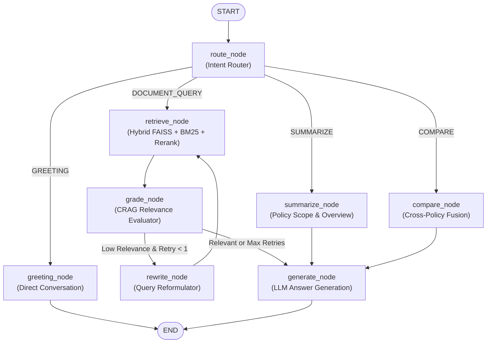

# CorpLens

**CorpLens** is an enterprise-grade **Agentic Retrieval-Augmented Generation (RAG)** platform designed to query, analyze, and extract actionable insights from corporate policy documents, employee handbooks, compliance manuals, and IT governance guidelines. Powered by **LangGraph**, it combines **Stateful Multi-Step Agent Workflows**, **Corrective RAG (CRAG)**, **Dense Semantic Vector Search (FAISS)**, **Sparse Lexical Retrieval (BM25)**, **Cross-Encoder Neural Reranking**, and **Role-Based Access Control (RBAC)** to produce verified, hallucination-resistant answers with exact citation attribution.

---

## Key Features

- **LangGraph Agentic Workflow**:
  - Implements a cyclic **LangGraph StateGraph** state machine.
  - **Dynamic Intent Routing**: Intelligently separates conversational greetings, executive policy summaries, cross-policy comparisons, and specific factual searches.
  - **Corrective RAG (CRAG)**: Evaluates retrieved context quality; if relevance is insufficient, it automatically reformulates the search query and re-runs retrieval.
  - **Multi-Policy Reasoning**: Coordinates comparative analyses across multiple corporate manuals simultaneously (e.g., comparing Employee Travel rules vs. Financial Procurement limits).
- **Hybrid Retrieval Pipeline**:
  - **Dense Retrieval**: Semantic embeddings powered by `sentence-transformers/all-MiniLM-L6-v2` stored in a **FAISS** vector index.
  - **Sparse Retrieval**: Keyword-level lexical search with **BM25** (`rank-bm25`) for exact policy terms and legal acronyms.
  - **Rank Fusion**: Weighted score blending combining semantic meaning with exact keyword matches.
- **Neural Cross-Encoder Reranking**:
  - Re-ranks candidate chunks using `cross-encoder/ms-marco-MiniLM-L-6-v2` to select the highest-relevance passages for LLM generation.
- **Role-Based Access Control (RBAC)**:
  - Document-level permission tagging and department filtering (`intern`, `employee`, `manager`, `legal`, `admin`) preventing unauthorized document access.
- **Grounded LLM Generation**:
  - Generates concise answers strictly backed by retrieved context using Hugging Face models (e.g., `google/flan-t5-base`, with support for `TinyLlama`).
  - Strict anti-hallucination guardrails with explicit bracketed citations (`[1]`, `[2]`).
- **Explainable Citations with Sentence Highlighting**:
  - Expandable source citation drawers in the UI highlighting the exact sentence evidence for compliance verification.
- **Interactive Streamlit Interface**:
  - Modern conversational chat UI featuring real-time **LangGraph Execution Trace visualizer**, parameter tuning, PDF upload, and role selection.

---

## LangGraph State Machine Architecture



---

## Project Structure

```
CorpLens/
├── app/
│   └── streamlit_app.py         # Streamlit web application with LangGraph Trace UI
├── data/
│   ├── corporate_docs/          # Corporate policy documents & pre-computed indices
│   │   ├── employee_handbook/   # Code of Conduct, Hybrid Work, PTO, Health Benefits
│   │   ├── infosec_policy/      # Data Classification, MFA, BYOD, Incident Response
│   │   ├── procurement_policy/  # Purchasing Thresholds, Travel Per Diems, Anti-Bribery
│   │   └── engineering_standards/ # SDLC, PR SLAs, Incident SEVs, Deployment Freezes
│   ├── raw/                     # Sample raw PDF documents
│   └── temp_index/              # Storage for on-the-fly uploaded & indexed PDFs
├── docs/
│   ├── architecture.md          # High-level architecture documentation
│   ├── devlog.md                # Chronological development log & engineering notes
│   └── experiments.md           # Model benchmarks and evaluation plan
├── scripts/
│   └── generate_corporate_docs.py # Automated corporate PDF generator & indexer
├── src/
│   ├── agent/                   # LangGraph Agentic System
│   │   ├── __init__.py
│   │   ├── langgraph_workflow.py # Compiled LangGraph StateGraph & Node functions
│   │   ├── router.py            # Intent classification (Greeting, Summary, Compare, Search)
│   │   ├── rewriter.py          # CRAG relevance evaluation & query reformulator
│   │   └── react_agent.py       # ReAct tool-calling agent orchestrator
│   ├── data/
│   │   ├── pdf_loader.py        # PDF text extraction using PyMuPDF (fitz)
│   │   ├── text_cleaning.py     # Cleans reference/bibliography sections
│   │   └── text_chunker.py      # Character-based sliding window chunking
│   ├── embeddings/
│   │   └── embedding_generator.py # Sentence-BERT embedding generator
│   ├── indexing/
│   │   └── build_index.py       # End-to-end document indexing pipeline
│   ├── inference/
│   │   └── query_engine.py      # CLI / backend query execution and testing
│   ├── models/
│   │   ├── llm_interface.py     # Hugging Face LLM loader & streaming logic
│   │   ├── model_manager.py     # Singleton model cache for embeddings & LLM
│   │   └── prompt_templates.py  # Prompt formatting with anti-hallucination rules
│   ├── retrieval/
│   │   ├── bm25_retriever.py    # BM25Okapi sparse lexical retriever
│   │   ├── hybrid_retriever.py  # Hybrid dense + sparse score fusion
│   │   ├── reranker.py          # Cross-encoder re-ranking module
│   │   └── vector_store.py      # FAISS index builder and vector search
│   └── utils/
│       ├── highlighting.py      # Sentence-level evidence highlighting
│       └── roles.py             # Role-based access control (RBAC) definition
├── main.py                      # Application launcher entry point
├── requirements.txt             # Python dependencies (includes langgraph, langchain)
└── readme.md                    # Project documentation
```

---

## Built-In Corporate Documents

CorpLens comes pre-packaged with 4 realistic enterprise policy documents:

| Document | Department | Access Roles | Key Topics Covered |
| :--- | :--- | :--- | :--- |
| **Employee Workplace Handbook** | `general`, `hr` | Intern, Employee, Manager, Legal, Admin | Hybrid & remote work policies ($500 home stipend, $50 internet), core hours (10 AM-4 PM EST), 20 days PTO, 16 weeks parental leave, 401(k) 5% match, 60-day PIP, moonlighting limits. |
| **Information Security & IT Policy** | `legal`, `general` | Legal, Admin | 4-tier data classification, 16+ char passphrase, hardware MFA (SMS 2FA banned), AI acceptable use (public LLM restrictions), 60-min breach SLA, cloud key management. |
| **Financial Procurement Governance** | `finance` | Manager, Admin | Travel per diems ($75 domestic, $120 international), flight rules (>6h business class allowed), purchase approval tiers ($1k-$50k+), gift limits ($50 cap), anti-bribery. |
| **Software Engineering Standards** | `engineering`, `general` | Employee, Manager, Admin | Trunk-based SDLC, PR review SLAs (24h), min 80% test coverage, SEV-1 to SEV-3 incident SLAs, Friday deployment ban, canary rollouts, PII log scrubbing. |

---

## Getting Started

### 1. Prerequisites
- Python 3.10+
- Git

### 2. Installation

Clone the repository and install the dependencies:

```bash
# Clone the repository
git clone https://github.com/your-username/CorpLens.git
cd CorpLens

# Activate virtual environment
# Windows:
cl\Scripts\activate

# macOS/Linux:
source cl/bin/activate

# Install dependencies (includes LangGraph and LangChain)
pip install -r requirements.txt
```

### 3. Generate & Index Corporate Documents
Generate the sample corporate policy PDFs and pre-compute the vector indices:
```bash
python scripts/generate_corporate_docs.py
```

---

## Running the Application

### Launch Streamlit Chat Interface
```bash
streamlit run app/streamlit_app.py
```
Or via the entrypoint script:
```bash
python main.py
```
Open your browser at `http://localhost:8501`.

### Run Terminal Query Test
```bash
python -m src.inference.query_engine
```
